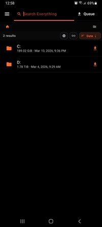
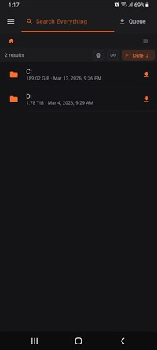
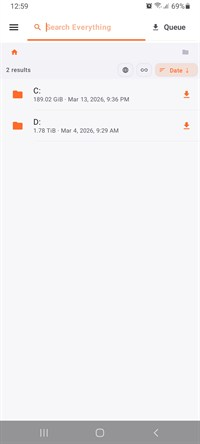
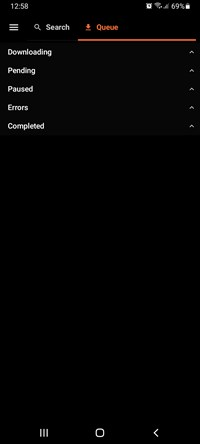
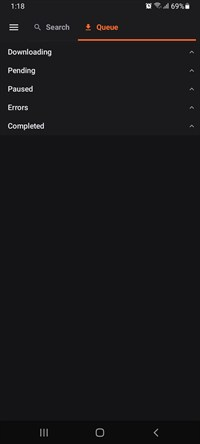
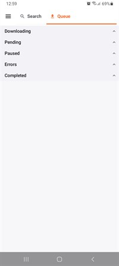

<h1 align="center">
  
  EverythingClient
</h1>

  An Android client for browsing and downloading files from an Everything HTTP server, with a fast, modern interface.

---

## Disclaimer

This project was vibe-coded with help from Claude, Codex, and Gemini.

## Everything Server (by voidtools)

Everything is a fast filename search engine for Windows, created by voidtools.

Useful links:

- [Everything (voidtools)](https://www.voidtools.com/support/everything/index.html)
- [Everything HTTP Server documentation](https://www.voidtools.com/en-au/support/everything/http/)
- [How to set up the HTTP Server plugin](https://voidtools.com/support/everything/options/#http_server)

## Features

- **Fast Search**: Search indexed files with filters and sorting controls.
- **Scoped Search**: Search within your current location or across all indexed files.
- **Advanced Downloads**: Queue downloads, track their progress, and pause or resume them when needed.
- **Multi-part Downloads**: Improve transfer speeds when downloading large files.
- **Dedicated Queue**: Keep track of active, paused, and completed downloads in one place.
- **Server Profiles**: Switch between server profiles quickly and test connections.
- **Modern UI**: Choose between Light, Dark, and AMOLED themes.

## Tech Stack

- **Kotlin + Jetpack Compose** for the Android app and user interface.
- **Hilt** for dependency injection.
- **Paging 3** to handle large sets of search results.

## Screenshots

  <table style="border-collapse: collapse; border: 1px solid #30363d;">
    <tr>
      <th style="border: 1px solid #30363d; padding: 8px;" align="center">Search (AMOLED)</th>
      <th style="border: 1px solid #30363d; padding: 8px;" align="center">Search (Dark)</th>
      <th style="border: 1px solid #30363d; padding: 8px;" align="center">Search (Light)</th>
    </tr>
    <tr>
      <td style="border: 1px solid #30363d; padding: 8px;" align="center">
        
      </td>
      <td style="border: 1px solid #30363d; padding: 8px;" align="center">
        
      </td>
      <td style="border: 1px solid #30363d; padding: 8px;" align="center">
        
      </td>
    </tr>
    <tr>
      <th style="border: 1px solid #30363d; padding: 8px;" align="center">Queue (AMOLED)</th>
      <th style="border: 1px solid #30363d; padding: 8px;" align="center">Queue (Dark)</th>
      <th style="border: 1px solid #30363d; padding: 8px;" align="center">Queue (Light)</th>
    </tr>
    <tr>
      <td style="border: 1px solid #30363d; padding: 8px;" align="center">
        
      </td>
      <td style="border: 1px solid #30363d; padding: 8px;" align="center">
        
      </td>
      <td style="border: 1px solid #30363d; padding: 8px;" align="center">
        
      </td>
    </tr>
  </table>

## Build

1. Open the project in Android Studio.
2. Sync Gradle.
3. Generate the APK.

## License

MIT License.
